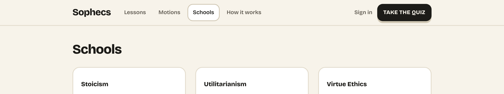
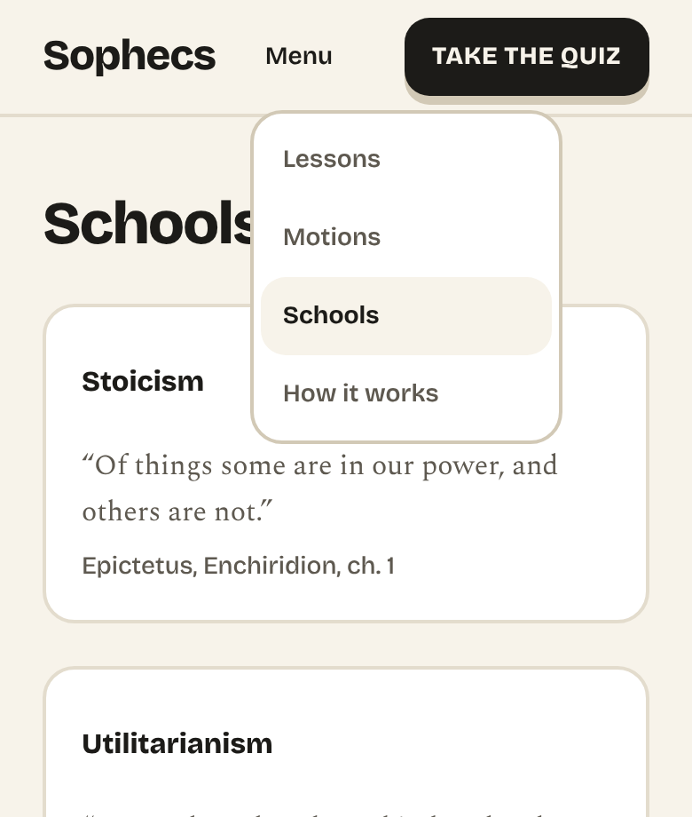
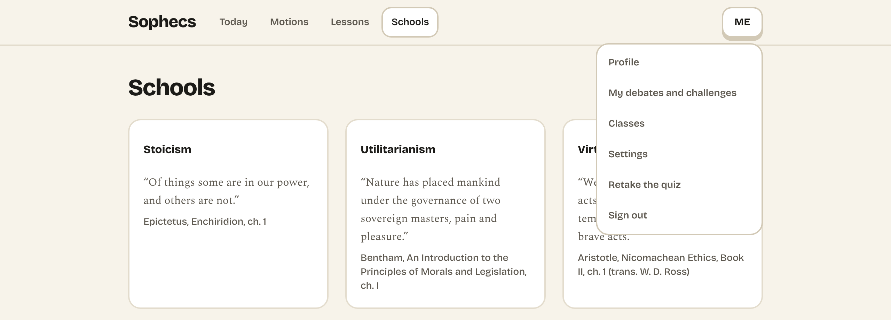
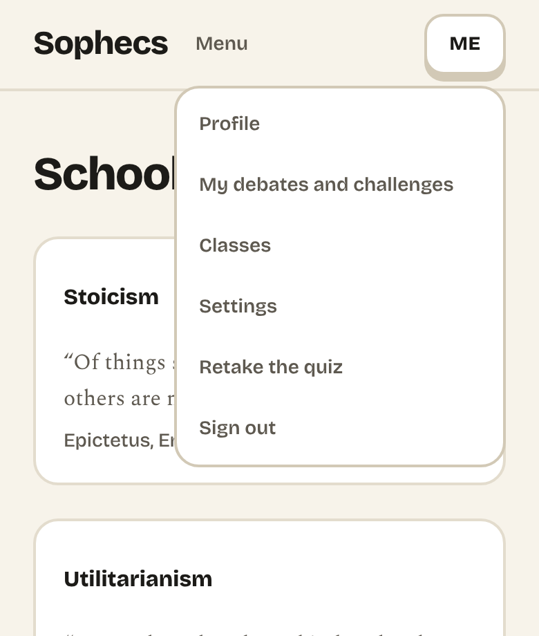
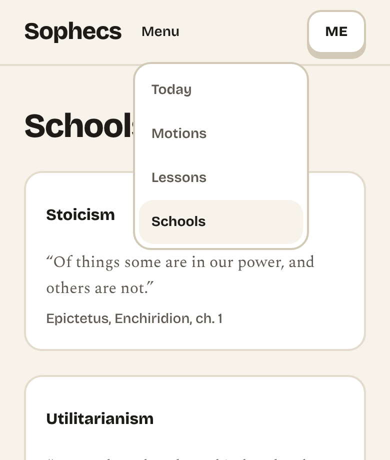

# Gate 4

Written on 2026-11-06, after the full v3 run, Gate 3 and the new-schools
run, as your ruling of that day ordered: "full v3 run, then Gate 3 and
the new-schools run, then Gate 4." Gate 4 is the launch of the six
schools; at Checkpoint B you said "not yet. Bring me Gate 4 once the
golden runs pass." Every open item below is yours to decide, Arthur, except the list
under Housekeeping, which is mine. Each names the file it lives in.
Nothing here is decided by being written down.

What shipped is in `docs/progress.md`; why, in `docs/decisions.md`; the
plan and the launch checklist, in `docs/stage5-plan.md` ("Gate 4
checklist").

## Ruled, 2026-11-07

Every item below was ruled on 2026-11-07, verbatim in `docs/decisions.md`,
"Gate 4: Arthur's rulings". In short, with where each stands:

| Item | Ruling | Done |
| --- | --- | --- |
| 1, 2 | Both misses accepted as known | Recorded; checklist ticked |
| 3 | Count the named voices | Fixtures widened |
| 4 | v3 in production at launch; cost accepted | COST comment updated; v3 comes with the flag |
| 5 | Option (ii) | Verdict page, share line, `/me` and the `revision_judged` event; one new line of copy, for your ruling |
| 6 | Criteria into `rubric.ts` at launch | On the launch checklist |
| 7 | v3's head comment as sent, stale by design | Recorded; draft header and COST comment fixed |
| 8 | v2 copy accepted, two fixes | Done (#102) |
| 9 | The 18 stances; seeding approved | Done (#103); seeded at 06:29 UTC and read back |
| 10 | The rubric shows v3's criteria for all six | Done on SIX_SCHOOLS builds (#102) |
| 11 | An exemplar floor | Done, at 50 (#102) |
| 12 | A pending reply holds the lapse clock; `/me` label | Done (#102) |
| 13 | Argument banks for the new three; samples to you first | Done: banks and samples (#104, `docs/gate4-samples.md`); the generator for six schools placed by quiz v2 (#105). The run itself waits for your word on the samples, and for the launch |
| 14 | Navigation as built | Nothing to do |
| 15 | Preview link and click-through when 8 to 13 are done; launch on your word | Sent with the click-through, `docs/gate4-clickthrough.md`; launch waits for your word |
| 16 | The SQL to you when the time comes | At the launch |

For your next list, from carrying these out:
- the line item 5 adds ("The first attempt was judged by an earlier
  version of the judge, so the two scores are not compared.",
  `docs/daily-path-copy.md`). It says "earlier" because every case that
  can arise is v2 then v3; "a different version" would stay true if the
  versions ever went the other way;
- that item 5 counts a sample's two template rules as two versions, so 3
  sample revisions (`sample-template-1` then `-2`) lose their table, with
  no line, since no judge wrote either; your ruling said prompt versions,
  and these are template rules;
- a frozen comment item 4 makes stale, in `src/app/api/judge/route.ts`:
  "At most $0.20 or so a reader a day at the COST comment's rate", which
  at v3's $0.0152 is about $0.30 (20 calls), left as it is;
- item 11's floor value, 50, which is mine: your ruling set a floor and
  no number. It is on the mark, as you said; under the sample run's
  current scoring rule a weak argument is now and then marked 50 or a
  little over, and at the canary's size the floor can leave a school, or a
  motion, with nothing to show (`docs/decisions.md`, "Gate 4: items 8, 10,
  11 and 12");
- item 12: a reply whose screening call keeps failing is retried daily
  and holds its exchange with no end, as "until it is screened" says;
  since the job takes the oldest first, 20 of them would take every run
  and starve newer replies (3, if each call times out rather than failing
  fast). And while screening is stopped (the kill switch on, the month's
  budget spent or unreadable), every exchange with a pending reply is
  held until it resumes, and the daily job answers 200, since nothing
  failed. Whether you want a limit on either;
- item 8: Utilitarianism's new share line [1], in
  `content/schools/utilitarianism.md`: "Turns out I'd pick whatever does
  the most good for the most people, even when I'm the one who pays for
  it. Sophecs called that Utilitarian." The words are mine, for your
  reading; it ships with #102;
- item 10: on a SIX_SCHOOLS build the rubric shows the v3 criteria as the
  judge gets them, including text written to the judge ("Of the rival
  schools this prompt lists", school ids in backticks). "In full"
  requires that; whether you want it presented differently;
- item 13: three readings the new schools' passages take, listed in
  `docs/decisions.md`, "Gate 4 item 13, first part": dependent origination
  read as spreading an AI harm's responsibility, which the criteria call
  an inference; Ubuntu's best-known objection (a community is not one
  voice) not stated in any objection; and Buddhist Ethics' (the gap to
  institutions) only obliquely;
- item 13, the run: the six schools are equally likely in a fresh run,
  which is mine (the live three's 40, 35 and 25 had no counterpart for
  six), and the nine lines a template verdict uses to praise an argument
  for standing on a new school's ground, in `scripts/seed/verdicts.ts`
  (`FEATURE`), are mine too, for your reading. Two more: most exchanges
  between the six open with no objection to raise, since in 18 of the 30
  pairings of two schools, taken one way round, the passages give none,
  so they argue past each other more than the live three's do; and a fresh run's base window
  still starts on 2026-09-18, so its quiz v2 results and the new three's
  arguments are dated weeks before readers could have made them;
- item 13, three things the run's verdicts do that I left as they are,
  since changing them would change rows the live run has written; the
  fresh run is the one chance to change them, for it alone. About half of
  revision verdicts keep the first attempt's weakest move, "The argument
  never meets an objection.", while saying the revision now meets one;
  about 1 in 8 say the revision now answers an objection and still
  suggest answering it (both `templateRevisionVerdict`); and a school
  whose name ends in "s" takes "'s", so a fresh run writes "Buddhist
  Ethics's" as the live run writes "Virtue Ethics's" (the templates that
  write `` `${NAME(…)}'s` ``). All three are in
  `scripts/seed/verdicts.ts`;
- found while checking the click-through: the method page's "Known
  limitations" says "Verdict quality is still being checked against real
  arguments. That is why judging is paused rather than running."
  (`src/components/how-it-works/JudgeMethod.tsx`; written in `a43753e`,
  2026-10-05).
  Production judges, so the second sentence is untrue on production's
  `/method` today, and on `/how-it-works` after the launch. The judge's
  other paused copy reads the kill switch (`docs/daily-path-copy.md`, Q2);
  this line does not. Whether to cut the sentence, or have it read the
  switch as the others do, is yours.

## Where things stand

- **Judge v3 (#90).** The 4 Nov head comment is sent again, by your
  reversal of ruling 12. The full run of 16:58 UTC passes 23 of 25 cases
  (`docs/decisions.md`, "Judge v3: the head comment sent again").
- **Gate 3 (#97).** A SIX_SCHOOLS build judges all six: v3, the six as
  rivals, the three's approved criteria from the draft file. A build
  without the flag, production included, sends what it sent
  (`docs/decisions.md`, "Gate 3: the three judged on SIX_SCHOOLS
  builds").
- **The new-schools run (18:14 UTC).** As a flag-on build would judge,
  all 25 cases: 23 of 25 in every band; counting the objection, 16 or 23
  of 25 pass in full, depending on item 3 below.
- **Eval key:** $12.2431 of the $15.00 cap, over 18 run files.
- **Stage 5.** Steps 1, 2 and 4 are done on flag-on builds, and step 3
  on every build. Of step 5, "debating as a new school", the judge is
  done; the arena already pairs any two readers of different schools
  (`seekCounterpart` in `src/app/debate/actions.ts`), and migration 0014
  lets an exchange hold any of the six; the topics' stances were item 9,
  now done (#103), and you ruled the elsewhere passages enough on
  micro-lessons for launch.
- **Production** shows and judges the three published schools exactly as
  before. Nothing promotes a flag-on preview to Production.
- **The navigation restructure** you asked for on 2026-11-06 is merged
  (#99, then #100 for your rulings on it): its copy in
  `docs/daily-path-copy.md`, section 13, your request in
  `docs/decisions.md`, and the screenshots of both menus, signed out and
  signed in, at 390 and 1280 pixels, in `docs/gate4/` (item 14).

## Do the golden runs pass? (b)

The checklist's first item is "The golden runs pass (the condition for
bringing Gate 4)". Both runs have every case in every band but two, the
same two. Counting the objection too, the full run passes 23 of 25, and
the new-schools run 16 or 23 of 25, depending on item 3.

1. **`confucian-hierarchy-school`**, your held-out case: roles argued
   faithfully in a school timetable, the power of teacher over pupil left
   unmet, which should hold engagement to 4. It fails in every run that
   sent the 4 Nov comment: 82/83/83 at 16:58 against a band of 40-75,
   engagement 5/6/6 against 0-4; 78/80/78 in the new-schools run, its
   engagement then 4/5/4, a median of 4, in band. Of the six runs that sent no comment,
   it was in band in three (22:08 on 5 Nov, 00:01 and 01:06 on 6 Nov) and
   out in the other three (76 at 01:38, 78 in each of steps A and B); in
   all six the strong cases fell out of band. No prompt tried has had
   both. Accept it as a known miss, or rule how to trade it against the
   strong cases.
   `tests/judge/golden/confucian-hierarchy-school.json`,
   `content/prompts/judge.v3.md`.
2. **`stoic-analogy`'s fidelity.** 7/7/7 at 16:58 and 7/8/7 at 18:14,
   against 8-10; its score in band both times. It passed on 4 Nov (8/7/8,
   a median of exactly 8). The one difference in body from the 4 Nov
   prompt is the paragraph crediting the concept over the vocabulary,
   kept because the 06:05 check that passed had it; your ruling's "if in
   doubt, drop the moved section" would also cover dropping it, at the
   cost of another full run: 25 cases, three samples, 75 calls (77 with
   retries at 16:58), about $1.17, against $2.76 left under the $15.00
   cap. But the exact 4 Nov prompt, without that paragraph, was run again
   at 01:08 on 6 Nov and gave this case fidelity 7 as well
   (`2026-11-06T01-08-52-100Z-v3.json`), and the same guidance stays in
   the head comment and in each school's criteria. So a rerun without the
   paragraph is not likely to move it. **I would accept it as a known
   miss.** `content/prompts/judge.v3.md`.
3. **Which objections count on a flag-on run.** Each golden fixture's
   expected objection schools were written for three rivals. On a
   flag-on build the prompt names, from the approved voices in
   `src/lib/judge/objection-voices.ts`, `ubuntu` as well for Stoicism,
   Utilitarianism and Confucianism and `confucian` as well for Buddhist
   Ethics, beside the voices each already had, and the judge follows
   them: 72 of the 75 objections in the new-schools run were a voice the
   prompt named, 19 of them one of those added. On the fixtures' sets
   16 of 25 cases pass outright; counting the named voices, 23 of 25.
   **I would count them**: the prompt tells the judge to use them, and
   the voices are yours. If so, the fixtures' sets are widened in
   `tests/judge/golden/*.json` to match, at no cost.

## The judge at launch: (b), and what follows from it

4. **Production judges with v3.** A flag-on build judges with v3, because
   v2 names the three published schools in its prose and asks for an
   objection from "the two schools the argument was not assigned", so it
   cannot judge a new school or name six rivals. So turning the flag on
   for Production moves every school's judging from v2 to v3. This was my
   reading of Gate 3, not a ruling. `src/lib/judge/schema.ts`.

   **It costs about 70% more a call.** v3's prompt is 13,238 bytes against
   v2's 4,794. On the live three's 14 cases, v2 averaged $0.00895 a call
   (26 Oct) and v3 $0.01519 (16:58; $0.01533 in the flag-on run). So the
   20-call daily ceiling, about $0.20 a reader a day under v2, becomes
   about $0.30, and the $50 monthly budget, which pauses judging when
   spent, covers about 40% fewer calls: some 3,300 rather than 5,600, a
   little fewer still since screening calls are paid from the same budget.
   (On the measured v2 figure the ceiling is about $0.18 now; the $0.20
   is the COST comment's estimate.)
   Spending (d), alongside the yes to v3.
5. **Verdicts already stored under v2.** After launch a revision of a v2
   original is judged under v3. The verdict page shows the revision's
   score change from the original, the share line writes it as
   "{first score} → {score}" when the objection was answered, `/me` shows
   the two scores side by side, and the `revision_judged` event records
   the change, so all of them would compare across versions; Elo and a
   topic's par would take v3 scores beside v2 ones. The rule in
   `docs/decisions.md` is that scores across versions are not compared as
   equivalent. How big the gap is can be read from the run files already
   committed: the v2 run of 26 Oct used today's `judge.v2.md`, and the
   16:58 run today's `judge.v3.md`. On the 13 live cases whose arguments
   have not changed since (all but `stoic-analogy`), v3's median score is
   0 to 12 points above v2's, and the same 0 to 12 on the six strong
   cases among them (`util-obscure-source` +12, `virtue-exemplar` +10,
   `stoic-strong` +8). The two runs are eleven days apart on the same
   model id.
   Options: (i) accept it; (ii) show no score change, in any of those
   places, when the two verdicts' versions differ, and leave Elo and par
   as they are; (iii) something else you rule. **I would take (ii).**
   `src/app/debate/[slug]/[debateId]/page.tsx` (which hands the page the
   original's scores, and where (ii) would go),
   `src/components/debate/Verdict.tsx` (which subtracts them),
   `src/lib/verdict-share.ts`, `src/components/me/ProfilePage.tsx`, and
   for the event the frozen `src/app/api/judge/route.ts`.
6. **The three's criteria at publishing.** Your ruling of 2026-10-24 keeps
   them in the draft file: "The live endpoint keeps refusing the three
   schools until I publish them in Phase 3" (`docs/decisions.md`,
   "Arthur's rulings of 2026-10-24, verbatim"). The
   flag-on loader reads only schools that are shown and not published, so
   the launch merge must move them into `src/lib/judge/rubric.ts` with
   the same text, or the judge would refuse the three once they are
   published. The flag-on request fixtures
   (`tests/judge-request/six-schools/`) pin that text, so the move can be
   shown to change nothing the judge receives. This needs your yes as
   part of the launch.
7. **Statements in frozen files that are, or become, untrue.** All are
   sent to the judge or describe what it is sent; each is yours to
   change:
   - `content/prompts/judge.v3.md`, the head comment, sent as written:
     "is not the production default" and "a draft to run the golden set
     against"; that the vocabulary paragraph "lives with the criteria,
     not in this file" (the body carries one); and it names `fillOnce`,
     which `src/` no longer has. Rewording it changes what the judge
     receives, (b), and so needs a full run, (d): the comment is what
     moved the strong cases by about ten points (the 06:05 check), and a
     run costs about $1.17 of the $2.76 left.
   - `content/prompts/fidelity-criteria.draft.md`, its header: "NOT
     LOADED BY ANYTHING IN PRODUCTION" and that `hasFidelityCriteria`
     returns false for the three (untrue at launch), and "One thing reads
     this file: the golden runner" (untrue on a flag-on build since
     Gate 3).
   - `src/lib/anthropic.ts`, the judge's COST comment, which describes
     what a call costs rather than what is sent: `est_in=1700` and
     `est_usd_per_call=0.0098` were written for v2 (item 4).

## Content and philosophy: (e)

8. **The v2 copy.** Every piece of text a reader sees only with quiz v2
   and the six schools on, beside what a reader sees now, with lines
   already ruled marked. Read and rule. `docs/stage5-plan.md`, "The v2
   copy, for the Gate 4 pack". Two lines in it I would point to:
   - Utilitarianism's share line [1] cites v1's self-driving-car
     question, which v2 does not ask (`content/schools/utilitarianism.md`).
   - On `/r/<id>`, the map's description for screen readers says "where
     you stand" to a reader looking at someone else's answers, while the
     title there says "them" (`src/components/phase3/SchoolMap.tsx`).
9. **The debate topics' stances for the three.** Each of the six topics
   gives a one-sentence stance for the three published schools only. A
   reader placed in one of the three sees the motion without "Your
   stance"; the list hides the line rather than breaking. But
   `tests/topic-stances.test.ts` requires a stance from every published
   school on every topic, so once the three are published (item 6) the
   tests fail without them: launching without stances means changing that
   test too. Writing them is content (`content/topics/*.md`, frozen) and
   then a production database write (a): `/debate` reads stances from the
   `debate_topics` table, which `npm run seed:topics` fills.

   The micro-lessons are per topic, but they argue from the original
   three schools (`crash-arithmetic-after`, for one, is Anscombe against
   Utilitarianism). Whether a reader of one of the new three needs more
   is also yours. `content/micro/*.md`, frozen.
10. **`/debate/rubric`** says "These are the criteria the judge is given
    for each school, in full", and shows `rubric.ts`'s v2 text for the
    published three. On a flag-on build, and so at launch, the judge is
    given v3's text, for six. Change the page's claim, or the page.
    `src/app/debate/rubric/page.tsx`; with #99, the text moves to
    `src/components/how-it-works/Rubric.tsx`, shared with `/how-it-works`,
    to which a flag-on build redirects `/debate/rubric`. The method page's
    closing sentence, kept on `/how-it-works` by your ruling of 2026-11-06,
    makes the same claim there ("published in full, including the
    fidelity criteria for each school"): `src/app/how-it-works/page.tsx`
    and `src/app/method/page.tsx`.
11. **A floor for exemplars.** On the full dataset none of the 72 chosen
    is one the sample run wrote to be weak; on the canary's rows alone, 4
    of 70 and 6 of 40 were, marked 28 to 36. A floor on the template mark
    would leave a position out rather than show a weak argument for it.
    `src/lib/exemplars.ts`; `docs/decisions.md`, the exemplars entry.
12. **The re-screening job's two open points and its copy.** Checkpoint B's
    (e) 8 was ruled ("Covered by the re-screening job; keep the copy
    accurate."); these are #89's follow-ups, put on your list under that
    number and not yet ruled (`docs/decisions.md`, the re-screening
    entry): the lapse clock runs from the exchange's last
    delivered reply, so a reply saved on day 13 that cannot be screened
    lapses with the exchange and is never delivered; `/me` lists an
    exchange whose latest reply is the reader's own pending one under
    "Reply", where the exchange page says it is waiting to be checked; and
    the new copy "A check that could not run is tried again once a day."
    (`src/lib/counterpart.ts`) and "waiting to be checked"
    (`src/components/counterpart/ExchangeView.tsx`).
13. **The fresh sample run after launch covers the original three only.**
    The generator's schools are the quiz's (`scripts/seed/banks.ts`,
    `SCHOOLS = QUIZ_SCHOOLS`), and it replays v1's quiz
    (`docs/sample-activity.md`). So the launch week's table would rank the
    original three on sample activity and show the new three unranked under the
    20-argument rule, and the exemplars pages would show three schools.
    Samples for the new three need new argument banks, which are content.
    Rule whether the run should cover them.
14. **The navigation's copy and screenshots** (#99). **Ruled
    2026-11-06, and carried out:** a quiet "Sign in" link beside "Take
    the quiz", in the Menu where the Menu is used; the Me items as
    built; the method page's closing sentence ("The criteria the judge
    is given are published in full ... Read the rubric.") kept on
    `/how-it-works`; `rubric_viewed` counted when that page's rubric
    section is seen; the redirects temporary until the launch and
    permanent (308) at it (item 15). `docs/decisions.md`, "Navigation:
    Arthur's rulings on #99". The copy is `docs/daily-path-copy.md`,
    section 13, with what is new marked: the two pages' descriptions;
    `/how-it-works`' contents line and that line's spoken name "On this
    page"; and the Exemplars link. Where the rulings left room, these
    were chosen, each yours to change (`docs/decisions.md`, the same
    entry):
    - **"Sign in" on a phone** is the Menu's last item, below a rule:
      beside the button it pushes the page sideways from 320 to 413
      pixels (36 at 360) and from 640 to 719 (up to 62).
    - **The bar starts at 768 rather than 640, for both readers,** so
      that "Sign in" sits beside the button wherever the bar is shown.
      Signed in, that means the Menu, not the bar, from 640 to 767, and
      the row's gaps are 12 pixels rather than 20 from 768 to 1023.
      `src/components/nav/SiteHeaderSix.tsx`.
    - **"Viewed"** is the rubric's section first reaching the upper half
      of the window, once a page view; a link to `#rubric` counts at once.
      `src/components/how-it-works/RubricSectionViewTracker.tsx`.
    - **The restored sentence's "Read the rubric"** links to the rubric's
      section on the same page. `src/app/how-it-works/page.tsx`.

    Taken from a served SIX_SCHOOLS build, with "Sign in":

    | | 1280 pixels | 390 pixels |
    | --- | --- | --- |
    | Signed out |  |  |
    | Signed in, Me |  |  |
    | Signed in, Menu | (the links are in the bar) |  |

    Signed out at 1280 pixels there is no menu: the four links, "Sign
    in" and the button are in the bar. The Menu is used below 768.

## Publishing: (c)

15. **The launch itself, on your instruction only,** and the rest of the
    checklist in `docs/stage5-plan.md`: the sample teardown; the flag on
    for Production with `next.config.ts`'s refusal removed, and with it
    the live table's 20-argument rule, which you ruled on 2026-11-06 to
    "apply it at launch with SIX_SCHOOLS, not before"; the three content
    files' status and colour tokens; the share lines and other front
    matter in the launch merge; the content judgements already ruled at
    Checkpoint B, carried out as ruled (the adherent nouns, (e) 1; the
    share lines, (e) 3; "a few minutes", (e) 4; `docs/quiz-v2.md`,
    section 8); `README.md`; the "until launch" rules of steps 3 and 4
    lifted; a fresh sample run (item 13). Between the teardown and that
    run, `/debate/{slug}/exemplars` answers not found while the landing
    page links to it (`docs/decisions.md`, the exemplars entry), and,
    with #99, while each motion card in the list does. In the launch
    merge, the navigation's three redirects (`/table`, `/method`,
    `/debate/rubric`) are made permanent (308), as you ruled on
    2026-11-06.

## Production database writes: (a)

16. **Clearing the preview's v2 results before the launch merge**, as the
    checklist sets out: `challenge_from` set to null where a genuine row
    points at one, a real reader's challenge with a v2 challengee reopened
    rather than deleted, and `debates.challenge_id` set to null where it
    points at a cleared challenge. The SQL comes to you for the SQL
    Editor.

## New, and waiting on you

- **`CRON_SECRET`.** The project has none, so both cron jobs, the
  keep-alive and the re-screening job, probably answer 401 and do
  nothing (`docs/progress.md`, 2026-11-07). Vercel's settings,
  Environment Variables: `CRON_SECRET`, sensitive, Production only, a
  random value of 32 characters or more, then a redeploy. It is a
  secret, so it is yours to set rather than mine. It turns the
  re-screening job on, which pays for screening whenever a reply is
  pending, as you approved under (d) 4.

## Still waiting on you from before

- Supabase Auth's Site URL and redirect list, and the Vercel redirect
  from `www.sophecs.com` to `sophecs.com`.

## Housekeeping

Mine, and not waiting on anyone:

- Once `CRON_SECRET` is set: run the keep-alive once and read that
  request's status code in the request logs. The runtime log cannot
  show it: neither cron route writes to it on any path.
